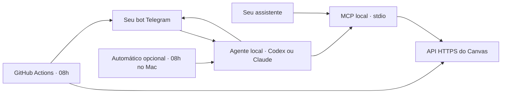

<p align="center">
  
</p>

<p align="center">
  <a href="https://github.com/arthurcuri/mcp-instructure-canvas/actions/workflows/ci.yml"></a>
  <a href="LICENSE"></a>
  
  
</p>

# Canvas MCP

**Acesse seu Canvas pelo assistente, receba prazos no Telegram e peça ajuda com atividades.**
Um único repositório reúne três funcionalidades independentes. A instância é
configurável; os exemplos usam o Canvas da PUC Minas.

| Funcionalidade | O que faz | Onde executa | Consome quota de IA? |
|---|---|---|---|
| **1 · MCP do Canvas** | Consulta matérias, lê enunciados e acessa a API para editar/enviar | Seu cliente inicia o processo local | O MCP não; o assistente que usa as ferramentas pode consumir |
| **2 · Lembretes** | Envia ao Telegram as atividades dos próximos sete dias | GitHub Actions, diário às **08h São Paulo** | **Não** |
| **3 · Agente** | Conversa pelo bot, prepara trabalhos e envia quando autorizado; modo automático opcional | Codex ou Claude Code no seu computador | **Sim, pela assinatura do agente** |

> **Escolha seu caminho:** apenas Canvas no assistente → funcionalidade 1.
> Apenas alertas → funcionalidade 2. Conversar ou automatizar trabalhos → funcionalidade 3.
> Você pode combinar as três; instalar o projeto não ativa jobs nem resolve atividades.

## Navegação

[Instalação e token](#instalação-e-token) · [MCP e clientes](#1--mcp-do-canvas) ·
[Lembretes das 08h](#2--lembretes-no-telegram) · [Agente Codex/Claude](#3--agente-para-atividades) ·
[Modo automático](#modo-manual-ou-automático) · [Conectar sua conta/chat](#como-meu-chat-e-minha-conta-se-conectam) ·
[Solução de problemas](#solução-de-problemas) · [Desenvolvimento](#desenvolvimento-com-agentes-de-ia)

## Arquitetura e deploy



O MCP roda como um processo iniciado pelo cliente: não abre uma porta pública.
O agendamento na nuvem inicia um runner temporário, lê o Canvas, envia o resumo e
encerra. O agente roda localmente. **Esses três fluxos não exigem deploy de um servidor MCP.**

| Situação | Precisa do computador ligado? | Precisa deixar um chat/Terminal aberto? |
|---|---|---|
| MCP em Codex, Claude Code, Claude Desktop ou IDE | Sim, durante o uso local | O cliente inicia o MCP |
| Lembrete pelo GitHub Actions | Não | Não |
| Receptor Codex instalado com `canvas-agent start` no Mac | Sim, com sessão iniciada e internet | Não: usa um LaunchAgent |
| Claude Channels em segundo plano | Sim | A sessão precisa continuar disponível; veja fixação abaixo |
| Trabalhador automático local | Sim | No Mac, o agendador inicia o processo |

O horário do GitHub Actions pode atrasar; não é um alarme com minuto garantido.
Um computador dormindo/desligado não responde pelo agente. Para clientes que
exigem uma URL remota, seria necessário hospedar e autenticar outro transporte;
esta versão fornece MCP local por stdio.

## Instalação e token

### Obter um token pessoal do Canvas

Este fluxo serve para seu próprio protótipo local. O token usa as permissões da
sua conta; não é uma chave de API da Anthropic ou da OpenAI.

1. Abra o Canvas da instituição, por exemplo [Canvas PUC Minas](https://pucminas.instructure.com), e faça login.
2. Entre em **Conta → Configurações**. Dependendo da interface, abra primeiro seu perfil.
3. Procure **Integrações aprovadas / Approved Integrations**.
4. Clique em **Novo token de acesso / New Access Token**, se essa opção estiver disponível.
5. Informe uma finalidade, como `MCP local Canvas`, e a expiração solicitada pela instituição.
6. Gere o token e copie o valor para seu arquivo `.env`, conforme a próxima seção.
   O Canvas não mostra novamente o valor gerado; se perdê-lo, será necessário criar outro.
7. Guarde qualquer anotação de validade somente no `.env` ou em `.local/`, ambos ignorados pelo Git.

Se a instituição não mostrar o botão, bloquear a geração ou exigir autorização,
solicite acesso à API ao administrador do Canvas ou ao suporte de TI. Não use
sua senha do portal como token. A documentação oficial descreve a
[geração manual de tokens](https://developerdocs.instructure.com/services/canvas/oauth2/file.oauth#manual-token-generation).

Para oferecer uma aplicação a vários usuários, o Canvas exige o fluxo OAuth,
com uma chave de desenvolvedor fornecida pelo administrador. Este projeto ainda
não implementa OAuth; cada instalação pessoal mantém suas próprias credenciais.
Veja [autenticação oficial](https://developerdocs.instructure.com/services/canvas/oauth2/file.oauth).

### Instalar o projeto

Os comandos abaixo são para macOS/Linux. É necessário Git e Python 3.11+.
O projeto usa Python 3.12 por padrão, que o uv pode instalar automaticamente.

#### Instalar o uv

No macOS com Homebrew:

```sh
brew install uv
uv --version
```

Para outros métodos, consulte a [instalação oficial do uv](https://docs.astral.sh/uv/getting-started/installation/).

#### Clonar e instalar as dependências

```sh
git clone https://github.com/arthurcuri/mcp-instructure-canvas.git
cd mcp-instructure-canvas
uv sync --locked
```

Se o projeto já estiver clonado, abra seu diretório e execute apenas `uv sync --locked`.
O uv cria `.venv/` e instala as versões de `uv.lock`.

#### Preparar a configuração privada

Crie o arquivo somente se ele ainda não existir:

```sh
if [ ! -f .env ]; then cp .env.example .env; fi
chmod 600 .env
nano .env
```

No editor, preencha `CANVAS_API_TOKEN` com o valor obtido no Canvas. Não passe o
valor pelo comando de registro do MCP nem o publique em configurações de clientes.

| Variável | Como preencher |
|---|---|
| `CANVAS_API_URL` | Origem HTTPS do Canvas, com ou sem `/api/v1`; por exemplo `https://pucminas.instructure.com/api/v1` |
| `CANVAS_API_TOKEN` | Seu token pessoal; obrigatório |
| `CANVAS_DEFAULT_COURSE_ID` | Opcional: número presente no endereço de uma matéria, depois de `/courses/` |
| `CANVAS_TIMEZONE` | Fuso dos prazos; padrão `America/Sao_Paulo` |
| `CANVAS_TOKEN_EXPIRES_AT` | Opcional: anotação privada da validade em `YYYY-MM-DD`; não altera a validade no Canvas |
| `CANVAS_READ_ONLY` | `false` por padrão habilita escrita; `true` oculta ferramentas de escrita e bloqueia mutações no cliente HTTP |
| `TELEGRAM_BOT_TOKEN`, `TELEGRAM_CHAT_ID` | Necessários para os lembretes e o agente pelo bot |
| `CANVAS_AGENT_AUTO` | **`false` por padrão:** aguarda seu pedido. **`true`:** autoriza o trabalhador local a preparar e enviar atividades pendentes |
| `CANVAS_AGENT_PROVIDER` | `codex` ou `claude`, escolhido pelo `canvas-agent setup`; vazio significa que nenhum agente foi escolhido |

Exemplo de identificação: em `https://canvas.example.edu/courses/12345`, o curso
é `12345`. Sem um curso padrão, informe `course_id` nas ferramentas de uma matéria
ou use `all_courses=true` na consulta de prazos.

Variáveis do processo prevalecem sobre o arquivo. O parâmetro `--env-file` permite
usar um caminho explícito, evitando depender do diretório em que o cliente abriu.

#### Verificar o acesso

```sh
uv run canvas-mcp-server --test
uv run canvas-mcp-server --config
```

`--test` consulta seu perfil e, se configurado, o curso padrão e suas atividades.
`--config` mostra a configuração sem exibir o token. Ambos encerram após a consulta.
O token e qualquer anotação pessoal permanecem em arquivos ignorados.

## 1 · MCP do Canvas

<a id="3-conectar-a-um-cliente-mcp"></a>

São **18 ferramentas MCP**, com catálogo embarcado de **1.118 operações REST em
144 grupos**, mais GraphQL e transferência de arquivos. O token mantém as permissões
da sua conta: recursos de professor/administrador exigem esses papéis no Canvas.

Os clientes usam o **mesmo servidor e as mesmas ferramentas**. Seus arquivos
de instruções ajudam o agente a trabalhar neste repositório; a configuração MCP
é o que permite consultar o Canvas.

Modelos versionados usam caminhos fictícios e nenhum token. As cópias com caminhos
reais são ignoradas pelo Git. Se você já tiver uma configuração, acrescente somente
a entrada `canvas-pucminas`, preservando as outras entradas e preferências.

### Claude Code

Na raiz do projeto:

```sh
claude mcp add --scope local --transport stdio canvas-pucminas -- \
  "$PWD/.venv/bin/canvas-mcp-server" --env-file "$PWD/.env"
claude mcp get canvas-pucminas
```

O escopo `local` salva um registro privado em `~/.claude.json`, associado a este
projeto. Abra uma nova sessão no diretório do projeto e use `/mcp` para conferir
as ferramentas. O registro contém o comando e o caminho do `.env`, sem copiar o token.

Também existe o modelo [examples/mcp.json](examples/mcp.json) para um registro em
`.mcp.json`. Adapte os caminhos e escolha um dos dois registros para evitar duplicação.
A pasta [.claude](.claude/README.md) contém orientações e regras para contribuir com Claude Code.

### Codex

Na raiz do projeto:

```sh
codex mcp add canvas-pucminas -- \
  "$PWD/.venv/bin/canvas-mcp-server" --env-file "$PWD/.env"
codex mcp get canvas-pucminas
```

O registro fica em `~/.codex/config.toml`. Abra uma nova sessão do Codex e confira
`/mcp`. Para uma configuração restrita ao projeto, copie
[.codex/config.toml.example](.codex/config.toml.example) para `.codex/config.toml`,
adapte os caminhos e abra o projeto como confiável. Se a configuração já existir,
mescle a seção em vez de substituir o arquivo.

O Codex lê `AGENTS.md` automaticamente. Veja [.codex/README.md](.codex/README.md) e a
[documentação de configuração por projeto](https://learn.chatgpt.com/docs/config-file/config-advanced).

### Gemini CLI

1. Conclua a instalação e o teste de conexão acima.
2. Copie o modelo, se ainda não existir uma configuração:

   ```sh
   if [ ! -f .gemini/settings.json ]; then cp .gemini/settings.json.example .gemini/settings.json; fi
   ```

3. Substitua os dois caminhos absolutos em `.gemini/settings.json`: o executável
   `.venv/bin/canvas-mcp-server` e o `.env`.
4. Reinicie Gemini CLI neste projeto e use `/mcp` para conferir a conexão.
5. Use `/memory show` para verificar as instruções do `GEMINI.md`, que importa `AGENTS.md`.

A cópia local é ignorada. Veja [.gemini/README.md](.gemini/README.md),
[configuração MCP](https://geminicli.com/docs/tools/mcp-server/) e
[configuração de contexto](https://geminicli.com/docs/get-started/configuration/).

### Cursor

1. Conclua a instalação e o teste de conexão.
2. Copie [.cursor/mcp.json.example](.cursor/mcp.json.example) para `.cursor/mcp.json`,
   se o arquivo ainda não existir; caso contrário, mescle a entrada do servidor.
3. Substitua os caminhos absolutos do executável e do `.env`.
4. Abra o projeto no Cursor e confira/reconecte o servidor nas configurações de MCP.
5. As regras de desenvolvimento são carregadas de `.cursor/rules/`; `AGENTS.md`
   também é suportado pelo Cursor.

Veja [.cursor/README.md](.cursor/README.md), [MCP no Cursor](https://cursor.com/docs/mcp)
e [regras do projeto](https://cursor.com/docs/rules).

### Kiro

1. Conclua a instalação e o teste de conexão.
2. Copie [.kiro/settings/mcp.json.example](.kiro/settings/mcp.json.example) para
   `.kiro/settings/mcp.json`, se ainda não existir; caso contrário, mescle a entrada.
3. Substitua os caminhos absolutos do executável e do `.env`.
4. Abra o painel de MCP do workspace do Kiro e confira/reconecte o servidor.
5. O Kiro recebe as orientações de `.kiro/steering/` e do `AGENTS.md` do projeto.

Veja [.kiro/README.md](.kiro/README.md), [configuração MCP](https://kiro.dev/docs/mcp/configuration/)
e [steering](https://kiro.dev/docs/steering/).

### Claude Desktop e outros clientes

Adapte [examples/mcp.json](examples/mcp.json) para a configuração `mcpServers` do
cliente, com caminhos absolutos. Para a instalação manual no Claude Desktop,
veja a [documentação de servidores locais](https://support.claude.com/en/articles/10949351-getting-started-with-local-mcp-servers-on-claude-desktop).
Esta versão não fornece uma extensão `.mcpb` empacotada.

Claude Code e Codex foram verificados nesta instalação. Os modelos dos demais
clientes seguem suas documentações oficiais; suas interfaces não fazem parte
dos testes automatizados deste repositório.

### Usar o Canvas pelo assistente

Depois de conferir o MCP no seu cliente, faça perguntas como:

- “Liste minhas matérias e mostre os IDs.”
- “Quais atividades da matéria 12345 vencem nesta semana?”
- “O que vence nos próximos sete dias em todas as minhas matérias?”
- “Leia a descrição completa da atividade X e explique os requisitos.”
- “Mostre os módulos e as páginas de orientação da matéria.”

O curso padrão é usado quando `course_id` é omitido. Na consulta de prazos,
`all_courses=true` verifica todas as matérias com matrícula ativa. Os resumos
omitem descrições; o assistente pode usar a ferramenta de detalhes quando precisar.

| Ferramenta | Resultado |
|---|---|
| `list_courses` | Matérias com matrícula ativa; opção para incluir concluídas |
| `get_course` | Dados da matéria e texto completo do plano de ensino |
| `list_assignments` | Resumos, prazos e status da sua entrega; busca por título |
| `get_assignment` | Descrição completa, rubrica, disponibilidade e sua entrega |
| `get_due_assignments` | Atividades da semana ou dos próximos sete dias |
| `list_modules` | Módulos e todos os itens, com paginação por módulo |
| `list_pages` | Títulos e identificadores das páginas |
| `get_page` | Texto completo de uma página, identificado pelo seu slug |

`get_assignment` exige `assignment_id`; `get_page` exige `page_url`, o slug
retornado pela listagem de páginas ou módulos. As consultas de detalhes devolvem
todo o texto, com links e descrições de imagens, sem baixar os anexos.

#### Como os prazos são interpretados

- `period="this_week"`: segunda-feira às 00h até a próxima segunda-feira às 00h,
  com início incluído e fim excluído, no fuso configurado. Inclui prazos que já
  passaram dentro da semana.
- `period="next_7_days"`: do instante da consulta até sete dias depois, com fim excluído.
- As listagens pedem ao Canvas `override_assignment_dates=true` e
  `include[]=submission`, preservando as datas efetivas e a sua entrega.
- Entregas submetidas, em revisão, dispensadas ou corrigidas sem `missing` são
  excluídas por padrão. Use `include_completed=true` para incluí-las.
- Atividades sem prazo entram em `undated_count`, sem serem colocadas artificialmente no período.
- `missing` e `late` vêm do Canvas, sem inferência apenas porque uma data passou.

#### API completa, incluindo escrita

Além das oito consultas acima, o MCP oferece dez ferramentas:

| Ferramenta | Uso |
|---|---|
| `search_canvas_operations` | Buscar operações por termos em inglês, método e grupo |
| `get_canvas_operation` | Consultar parâmetros obrigatórios, enums e link da documentação |
| `canvas_api_read` | Executar GET do catálogo, com paginação automática de listas |
| `canvas_api_write` | Executar POST, PUT, PATCH ou DELETE; aceita JSON, formulário, multipart e corpo bruto |
| `canvas_api_download` | Salvar a resposta de um GET, como relatório/CSV/ZIP, em um arquivo local novo |
| `canvas_upload_file` | Executar as três etapas de upload, retornando o `file_id` |
| `download_canvas_file` | Baixar um anexo pela URL assinada, sem enviar o token ao armazenamento |
| `submit_assignment` | Enviar uma entrega real: texto, URL, arquivos e outros tipos aceitos pelo Canvas |
| `canvas_graphql_read` | Executar query ou introspecção GraphQL; rejeita mutations |
| `canvas_graphql_write` | Executar mutation GraphQL |

São **18 ferramentas MCP**, que dão acesso ao catálogo sem registrar 1.118
ferramentas separadas no contexto do assistente. O transporte cobre todos os
métodos/rotas do catálogo oficial obtido em 13/10/2026, incluindo `/api/v1`,
New Quizzes em `/api/quiz/v1` e rotas `/api/lti`. Consulte o
[guia da API](docs/api.md) para exemplos de execução e atualização do catálogo.

Peça, por exemplo: “Descubra a operação para enviar minha atividade e mostre os
parâmetros exigidos” ou “Envie este arquivo para a atividade X”. Para anexos,
o assistente faz upload e depois chama `submit_assignment` com o ID recebido.
**Upload sozinho não entrega a atividade.** Escritas não são repetidas
automaticamente; se a conexão cair, confira o Canvas antes de tentar novamente.

As quatro ferramentas de escrita são identificadas como mutações. Consultas
sem gravação têm `readOnlyHint=true`; os dois downloads indicam que criam arquivos
locais novos, embora consultem o Canvas sem alterar seus dados. Para usar apenas consultas, defina
`CANVAS_READ_ONLY=true` no `.env` e reinicie/reconecte o MCP no cliente.

O catálogo completo não amplia as permissões da conta: recursos de professor,
administrador ou LTI exigem os papéis e credenciais correspondentes. Não há OAuth
de aplicação implementado. Processos com várias etapas continuam exigindo os
parâmetros e a sequência da documentação oficial. Os testes de escrita usam HTTP
simulado; operações destrutivas não são testadas na sua conta.

## 2 · Lembretes no Telegram

<a id="5-preparar-a-checagem-semanal-no-mesmo-repositório"></a>

O resumo mostra **matéria, atividade, prazo local e link**, além da contagem de
atividades sem prazo. O diário consulta os próximos sete dias em todas as matérias
ativas. Ele lê a API diretamente: não precisa de um cliente MCP aberto nem usa IA.

### Criar o bot e descobrir seu chat

1. Abra [@BotFather](https://t.me/BotFather) no Telegram e envie `/newbot`.
2. Escolha nome/username e salve o token em `TELEGRAM_BOT_TOKEN` no `.env` privado.
3. Abra seu novo bot e envie `/start`. Antes de ligar um receptor, esse comando
   não produz resposta: ele permite descobrir a conversa.
4. Com **nenhum outro receptor/webhook usando o bot**, execute:

   ```sh
   uv run canvas-telegram-chats --env-file .env
   ```

5. Copie o ID da sua conversa privada para `TELEGRAM_CHAT_ID` no `.env`.
   Se aparecerem vários IDs, confirme qual pertence a você.
6. Teste um envio explícito:

   ```sh
   bash automation/run_weekly.sh --all-courses --telegram
   ```

Sem `--telegram`, o comando apenas salva `.local/weekly-report.json`, privado.
O comando de descoberta não deve rodar enquanto Codex/Claude estiver consumindo
updates. Use **um bot pessoal e um único receptor**.

### Agendar no GitHub Actions

| Frequência | Workflow | Horário | Variável |
|---|---|---|---|
| **Diária** | [daily-canvas.yml](.github/workflows/daily-canvas.yml) | **08h, America/Sao_Paulo** | `CANVAS_DAILY_ENABLED=true` |
| Semanal opcional | [weekly-canvas.yml](.github/workflows/weekly-canvas.yml) | Segunda, 09h17 São Paulo | `CANVAS_WEEKLY_ENABLED=true` |

1. No GitHub, abra **Settings → Secrets and variables → Actions → Secrets**.
2. Cadastre `CANVAS_API_TOKEN`, `TELEGRAM_BOT_TOKEN` e `TELEGRAM_CHAT_ID`.
3. Em **Variables**, configure `CANVAS_API_URL` e `CANVAS_TIMEZONE` se precisar
   mudar os padrões da PUC Minas/São Paulo.
4. Em **Actions → Daily Canvas reminder → Run workflow**, faça um teste manual.
5. Em **Variables**, ative `CANVAS_DAILY_ENABLED=true` e mantenha
   `CANVAS_WEEKLY_ENABLED=false` para evitar dois resumos na segunda.

Com o `.env` pronto e GitHub CLI autenticado, este comando realiza a configuração:

```sh
gh auth login
uv run python automation/configure_github.py --repo SEU_USUARIO/SEU_REPOSITORIO --activate
```

Ele envia somente os três secrets por stdin e configura URL/fuso. Sem `--activate`,
não muda as variáveis de ativação. O `.env` não é publicado no GitHub.
Para desligar, defina `CANVAS_DAILY_ENABLED=false`.

**Custo:** os runners padrão usados aqui são gratuitos para repositórios públicos,
conforme a [política do GitHub](https://docs.github.com/en/billing/concepts/product-billing/github-actions).
Repositórios privados têm a cota do plano; runners maiores podem ser cobrados.
Este job não chama Claude/OpenAI. Ele força somente leitura e não publica dados
acadêmicos como artifacts ou commits; os logs mostram contagens.

O GitHub pode atrasar schedules e desativá-los após 60 dias sem atividade em repos
públicos. Veja [schedules](https://docs.github.com/en/actions/reference/workflows-and-actions/events-that-trigger-workflows#schedule).
O [guia de automação](automation/README.md) também explica cron, launchd local,
frequência semanal, logs e desativação.

## 3 · Agente para atividades

<a id="6-conversar-pelo-telegram-com-codex-ou-claude-code"></a>

O agente usa o MCP para ler enunciado, rubrica, anexos e status da sua entrega,
prepara os arquivos e responde pelo bot. Trabalhos ficam em `.local/activities/`.
A conversa aceita somente o dono da conversa privada configurada. O lembrete
pode apontar outra matéria que o curso padrão: envie **nome ou link da atividade**.

### Configuração guiada: você escolhe a conta e ativa o serviço

Instale o CLI do provedor desejado, preencha Canvas/Telegram no `.env` e abra
um Terminal na raiz do projeto:

```sh
uv run canvas-agent setup
```

O assistente de configuração tem quatro etapas:

| Etapa | Sua escolha | O que o projeto faz |
|---|---|---|
| **1 · Agente** | Codex/ChatGPT ou Claude Code/Claude | Mostra as duas opções, sem escolher uma silenciosamente |
| **2 · Conta** | Usar explicitamente a conta exibida ou abrir o login oficial | Consulta o status do CLI; mostra email/plano no Terminal; só abre o login quando você escolher |
| **3 · Modo** | Manual ou automático | Explica se deve aguardar seu pedido ou resolver **e enviar** às 08h locais; Enter escolhe manual |
| **4 · Revisão** | Salvar e iniciar, salvar sem iniciar ou cancelar | Mostra provedor, conta, Canvas, destino Telegram e receptores ativos antes de alterar configuração/serviços |

Se escolher iniciar, o setup explica quais receptores serão parados para evitar
dois consumidores do mesmo bot. Salvar sem iniciar altera apenas as chaves
`CANVAS_AGENT_PROVIDER` e `CANVAS_AGENT_AUTO` do `.env`; serviços existentes seguem
com a configuração anterior até serem reiniciados. Cancelar a revisão não salva
essas escolhas nem altera serviços. Enter na revisão cancela.

O login oficial é compartilhado com os outros usos do CLI nessa máquina. Se abrir
e concluir um login, ele continua disponível no CLI mesmo que depois cancele a
configuração do bot. O setup não copia credenciais de ChatGPT/Claude para o `.env`.
A conta é exibida somente no seu Terminal, sem ser salva em logs ou configuração
pública. Consultar o login e configurar o receptor não inicia uma tarefa de IA.

Depois de salvar sua escolha, os comandos de controle ficam simples:

```sh
uv run canvas-agent status     # Mostra o provedor escolhido e ambos os receptores
uv run canvas-agent start      # Inicia o provedor escolhido no .env
uv run canvas-agent stop       # Para os receptores e o job local deste projeto
uv run canvas-agent login      # Abre o login oficial do provedor escolhido; não inicia o bot
```

Para trocar de Codex para Claude ou vice-versa, execute `setup` novamente e
revise a troca. Para scripts, `status --json` fornece saída estruturada.

> **O que significa `--provider`?** É uma escolha apenas para aquele comando.
> `start --provider codex` inicia Codex; `start --provider claude` inicia Claude.
> `stop --provider codex` apenas para Codex: não escolhe o próximo agente nem faz
> login/logout. O valor `code` é inválido. Uma flag não modifica a escolha salva
> no `.env`. Sem escolha salva ou flag explícita, `start` pede que você faça setup.

### Codex com assinatura ChatGPT

1. Instale [Codex CLI](https://developers.openai.com/codex/cli/).
2. Execute `uv run canvas-agent setup` e escolha **Codex / ChatGPT**. Você pode
   aprovar o uso da conta que o CLI já tem ou escolher abrir o login no navegador.
   Se preferir fazer o login oficial separadamente, use:

   ```sh
   codex login
   codex login status
   ```

3. Revise o modo e escolha **Salvar e iniciar agora**. O receptor recusa API key:
   esse caminho usa o login ChatGPT gerenciado pelo Codex. Se escolheu apenas salvar,
   no macOS inicie depois e confira:

   ```sh
   uv run canvas-agent start
   uv run canvas-agent status
   ```

4. Envie `/start` ao bot e depois `Me explique a atividade deste link: ...`.
   Você pode citar a mensagem do resumo ao responder. Arquivos pedidos podem
   voltar como anexos. A entrada pelo bot é **texto**; áudio, imagens e arquivos
   recebidos ainda não são interpretados pelo receptor Codex.
5. Para parar, preservando conversa e arquivos:

   ```sh
   uv run canvas-agent stop
   ```

`start` instala um LaunchAgent do projeto, ativo na sua sessão do macOS.
O runtime privado fica em `~/Library/Application Support/CanvasMCP/`, para que
launchd consiga iniciar projetos cujo checkout está em Documents/Desktop. Ele
mantém dependências e uma cópia privada do `.env` com permissão `600`; links em
`.local/` permitem acessar trabalhos, estado e ledger pelo repo. O `.env` da raiz
é a fonte de configuração. `prepare` monta a instalação, **sem ativar jobs**.

Depois de mudar código/credenciais/modo, faça `stop`, `uv sync --locked` e `start`
para atualizar a cópia usada pelo serviço. No Linux ou para diagnóstico, use
`uv run canvas-agent run --provider codex`: esse processo precisa continuar rodando;
configure seu supervisor/cron separadamente. A integração usa
[Codex App Server](https://learn.chatgpt.com/docs/app-server) por stdio e foi
verificada com Codex CLI 0.162.1.

| Comando no bot Codex | Efeito | Chama IA? |
|---|---|---|
| `/start`, `/help` | Ajuda | Não |
| `/status` | Estado e permissões pendentes | Não |
| `/cancel` | Interrompe o pedido ativo | Não inicia nova tarefa |
| `/reset` | A próxima mensagem inicia outra conversa; preserva arquivos | Não |
| `/approve CÓDIGO`, `/deny CÓDIGO` | Responde à permissão daquela operação | Não inicia nova tarefa |
| `/answer CÓDIGO resposta` | Responde a uma pergunta estruturada | Continua a tarefa existente |
| Texto com seu pedido | Inicia trabalho/conversa | **Sim** |

Permissões expiram em 15 minutos e tarefas do receptor têm limite de 30 minutos.
Uma conversa inicial sem histórico é recuperada automaticamente; conversas reais
removidas não são descartadas silenciosamente. Requests interrompidos não são
reexecutados ao reiniciar. A recuperação não repete entregas.

### Claude Code com assinatura Claude

1. Instale Claude Code atualizado e [Bun](https://bun.sh/docs/installation).
2. Abra `claude` neste projeto e aceite o diálogo de confiança do workspace.
   O login pela assinatura pode ser feito no setup ou com `claude auth login --claudeai`.
3. Instale o plugin oficial:

   ```sh
   claude plugin install telegram@claude-plugins-official --scope local
   ```

4. Execute o setup, escolha **Claude Code / Claude**, confira a conta e revise
   a ativação. Se houver Codex rodando, o setup mostra que ele será parado:

   ```sh
   uv run canvas-agent setup
   uv run canvas-agent status
   ```

5. Envie um pedido ao bot. Respostas e aprovações usam o plugin oficial;
   siga os botões/instruções apresentados por ele.
6. Para parar, use `uv run canvas-agent stop`.
   Em primeiro plano, use `uv run canvas-agent run --provider claude`.

**Channels precisa estar habilitado.** Em Team/Enterprise, o administrador deve
permitir `channelsEnabled`. Se o status indicar bloqueio por política da organização,
o administrador precisa habilitá-lo antes de receber mensagens pelo bot Claude.
Os testes do repositório simulam esse fluxo; eles não garantem que sua instituição
tenha habilitado Channels. Consulte [Channels](https://code.claude.com/docs/en/channels).

Sessões Claude ociosas podem ser encerradas: abra `claude agents` e fixe a sessão
com `Ctrl+T` para mantê-la disponível, conforme [agent view](https://code.claude.com/docs/en/agent-view).
A preparação gera `.local/agent/`, incluindo uma cópia privada apenas do token
Telegram no `.env` esperado pelo plugin. As configurações MCP apontam ao `.env`
que contém o token Canvas. Após trocar credenciais, pare e inicie novamente.

### Modo manual ou automático

```dotenv
# Padrão: só inicia uma resolução quando você pede; envio exige pedido explícito.
CANVAS_AGENT_AUTO=false

# Alternativa: autoriza o trabalhador local a resolver E enviar sem confirmação.
# CANVAS_AGENT_AUTO=true
```

| Comportamento | `false` · manual | `true` · automático |
|---|---|---|
| Resumo diário no GitHub | Continua independente, sem IA | Continua independente, sem IA |
| Trabalho no bot | Aguarda seu pedido | Você pode continuar conversando normalmente |
| Trabalhador local às 08h | Desativado | Procura atividades pendentes e disponíveis |
| Confirmação de resolução/entrega no trabalhador | Você escolhe o trabalho e pede o envio | A configuração é autorização prévia: prepara e envia |
| Quota do agente | Consome ao conversar/pedir trabalho | Consome também nas tarefas automáticas |
| Falta de dados, limite ou permissão | O agente pode perguntar | Registra necessidade de atenção; não envia conteúdo inventado |

**Para ativar:** edite o `.env`, use `CANVAS_AGENT_AUTO=true`, confirme que
`CANVAS_READ_ONLY=false`, pare e inicie o agente com o provedor escolhido.
Você também pode escolher o modo automático no `canvas-agent setup` e revisar
**Salvar e iniciar agora**; ele salva a chave e reinicia os receptores indicados.
No Mac, `start` instala também o trabalhador diário das **08h no fuso do macOS**.
Ele usa a mesma assinatura do provedor; pode trabalhar sem o receptor do bot,
pois somente envia mensagens e não disputa `getUpdates`.
Para desligar, volte a `false` e faça `stop`/`start`.

Execução manual do trabalhador, respeitando a chave:

```sh
uv run canvas-agent auto-run --provider codex
# ou
uv run canvas-agent auto-run --provider claude
```

Com `false`, esses comandos encerram sem consultar atividades nem chamar modelos.
No Linux, agende esse comando em seu cron/supervisor às 08h; ele não é instalado
automaticamente. Ajuste o fuso do sistema para o horário esperado. O fuso do
relatório (`CANVAS_TIMEZONE`) não muda o relógio do agendador local.

O trabalhador verifica **todas as matérias ativas**, com prazos futuros, sem
prazo ou vencidos enquanto a entrega ainda estiver disponível. Processa tarefas
sequencialmente e suporta entregas de **texto, arquivo ou URL**. Tipos de prova,
ferramentas externas, atividades em papel e tarefas bloqueadas são excluídos.
Dados empíricos, entrevistas e informações pessoais ausentes não são inventados.
Um trabalho incompleto ou uma permissão adicional negada exige atenção.

Cada tentativa é registrada antes de iniciar em `.local/agent-auto/ledger.json`.
Após o trabalho, o código consulta novamente a submissão do usuário no Canvas:
o texto do modelo não é prova de entrega. Tarefas tentadas, incluindo falhas ou
interrupções, não são repetidas automaticamente. Confira o resultado no Canvas;
para continuar uma que exige atenção, envie um pedido explícito pelo bot.
Permissões gerais e limites do cliente continuam valendo; o modo não habilita
bypass nem escrita fora do trabalho autorizado. O código de envio é testado com
HTTP/modelos simulados, sem entregar trabalhos reais para validar setup.

No Codex, o trabalhador usa uma conversa própria por atividade. No Claude, ele
executa uma sessão local `-p` com login da assinatura, Canvas MCP e sem prompts
interativos: permissões extras são negadas. Esse job de saída é independente do
Channels; receber mensagens pelo bot Claude continua exigindo Channels habilitado.
Não são usadas chaves de API OpenAI/Anthropic neste fluxo.

### Como meu chat e minha conta se conectam?

| O que você quer | Como conectar |
|---|---|
| Canvas direto no Codex/Claude Code | Registre o MCP na funcionalidade 1 e abra uma nova sessão |
| Conversar com o agente pelo Telegram | Execute `canvas-agent setup`, escolha provedor/conta e revise a ativação |
| Usar Claude Desktop com Canvas | Configure o MCP local conforme o exemplo/guia do Desktop |
| Reutilizar o histórico deste chat no bot | Ele mantém outra conversa; envie ao bot o contexto necessário |
| Usar apenas navegador/celular com um cliente que exige URL de MCP | Precisa de uma integração remota própria; este servidor é stdio local |

O bot usa **a conta autenticada no CLI da máquina**. Ele não se conecta a uma aba
já aberta do ChatGPT/Claude, nem importa seu histórico. O Codex cria e retoma sua
própria conversa pelo App Server; Claude Channels mantém a sessão Claude Code.
Depois de instalar, autenticar e iniciar, o receptor lê novas mensagens sozinho.
Para revisar a conta/provedor e reiniciar, execute `canvas-agent setup`.
As [documentações de autenticação Codex](https://learn.chatgpt.com/docs/auth) e
[Claude Code](https://code.claude.com/docs/en/authentication) explicam os logins.

## Solução de problemas

| Sintoma | Verificação/ação |
|---|---|
| “Pedido não iniciado” na versão anterior | Atualize o repo, instale dependências e faça `stop`/`start`. Conversas iniciais sem rollout agora são recuperadas |
| “Escolha seu agente” ao iniciar | Execute `canvas-agent setup`; `CANVAS_AGENT_PROVIDER` ainda está vazio. Flags explícitas são opcionais para scripts |
| Escolha salva diferente do receptor rodando | Foi escolhido salvar sem iniciar; execute `setup` novamente e revise a ativação |
| Conversa real removida | `/reset` inicia outra; preserva trabalhos. Não repita uma entrega sem conferir o Canvas |
| Bot não responde a `/start` | Inicie o receptor; confirme `canvas-agent status`, chat privado, Mac/internet e apenas um consumidor |
| Telegram HTTP 409 | Outro poller ou webhook disputa o bot; pare o concorrente |
| Canvas 401/403 | Confira validade do token/permissões institucionais e rode `canvas-mcp-server --test` |
| Claude `blocked_by_organization` | Administrador deve habilitar Channels. Use um provedor permitido |
| Modo mudou mas serviço continua igual | Pare/inicie para atualizar a cópia privada do `.env` |
| Automático não inicia | `CANVAS_AGENT_AUTO=true`, `CANVAS_READ_ONLY=false`, login válido, job instalado e fuso do macOS |
| “needs_attention” no ledger | Consulte o motivo e o Canvas; complete dados/solicite continuação explicitamente |
| Login/quota expirou | Pare, renove o login do CLI e inicie; os limites continuam sendo os da assinatura |
| GitHub deixou de enviar | Confira Actions, secrets, variável de ativação e desativação por inatividade |

Logs/estado ficam em `.local/codex-agent/`, `.local/agent/` e `.local/agent-auto/`.
Essas pastas e o `.env` são privados/ignorados. Na primeira instalação, mensagens
antigas são descartadas; envie `/start` de novo. O Telegram conserva updates por
período limitado, portanto indisponibilidade prolongada pode perder mensagens.
O envio ao Telegram não é repetido automaticamente após uma falha de transporte.

## Desenvolvimento com agentes de IA

As pastas abaixo têm orientações reais para quem desenvolve o projeto usando
cada ferramenta, além de modelos opcionais de configuração MCP:

| Cliente | Orientações versionadas | Modelo de configuração local |
|---|---|---|
| Claude Code | `CLAUDE.md` + `.claude/rules/repository.md` | `examples/mcp.json` |
| Codex | `AGENTS.md` + `.codex/README.md` | `.codex/config.toml.example` |
| Gemini CLI | `GEMINI.md`, que importa `AGENTS.md` | `.gemini/settings.json.example` |
| Cursor | `AGENTS.md` + `.cursor/rules/repository.mdc` | `.cursor/mcp.json.example` |
| Kiro | `AGENTS.md` + `.kiro/steering/repository.md` | `.kiro/settings/mcp.json.example` |

`AGENTS.md` é a referência comum para arquitetura, comportamento, proteção das
credenciais e validação. As orientações específicas apontam para ela.

```sh
uv sync --locked
uv run ruff check src tests scripts automation
uv run ruff format --check src tests scripts automation
uv run pytest -q
bash -n automation/run_weekly.sh
uv build
```

Os testes usam credenciais sintéticas e HTTP simulado. Para verificar o protocolo
MCP contra sua conta real, de forma opcional:

```sh
uv run python scripts/verify_mcp.py
```

Estrutura: `src/canvas_mcp/` para API, serviços, MCP e checagem semanal; `tests/`
para testes; `automation/` para agendamento; pastas dos agentes para contribuição;
`uv.lock` para dependências reproduzíveis e GitHub Actions para lint, testes e build.

## Solução de problemas

| Sintoma | O que conferir |
|---|---|
| Token recusado / HTTP 401 | Token expirado, revogado ou copiado incorretamente; atualize somente seu `.env` |
| HTTP 403 | Permissões da conta ou restrições da instituição |
| HTTP 404 | ID do curso/atividade ou acesso à matéria |
| Cliente não inicia o servidor | Execute `uv sync --locked` e confira o caminho absoluto de `.venv/bin/canvas-mcp-server` |
| `.env` não encontrado | Confira o argumento `--env-file`; um cliente pode iniciar fora da raiz do repo |
| Nenhuma atividade no período | Confira fuso, `period`, curso, entregas já concluídas e `undated_count` |
| Job falha, mas a execução manual funciona | Confira `CANVAS_UV_BIN`, caminhos absolutos, rede e logs em `.local/` |
| Token aparece configurado, mas o prazo mudou | A validade é controlada pelo Canvas; a anotação local não altera a credencial |

## Segurança e limites

`.env`, `.local/` e as configurações reais dos clientes ficam fora do Git.
Os modelos públicos não incluem credenciais, caminhos pessoais ou datas pessoais.
Erros HTTP não devolvem corpos de resposta e a configuração pública não exibe o token.

O servidor recusa redirecionamentos e links de paginação fora da API configurada,
aplica timeout e faz até duas novas tentativas de leitura em HTTP 429/503. Escritas
e mensagens ao Telegram têm uma única tentativa. Consultas que
excedem 100 páginas ou 10.000 itens falham explicitamente.

O token conserva as permissões concedidas pela instituição. O modo somente leitura
é uma restrição deste servidor. Transferências assinadas de arquivos usam um
cliente separado, sem encaminhar a credencial Canvas ao armazenamento.
O conteúdo consultado chega ao cliente/assistente que
você usar; suas políticas de retenção continuam aplicáveis. Conteúdo dos cursos
é dado externo, sem autoridade para pedir credenciais ou execução de comandos.
Consulte [SECURITY.md](SECURITY.md).

## Referências e licença

Implementação própria inspirada nos projetos
[vishalsachdev/canvas-mcp](https://github.com/vishalsachdev/canvas-mcp) e
[mbcrosiersamuel/canvas-mcp](https://github.com/mbcrosiersamuel/canvas-mcp).
Base técnica: [SDK oficial MCP, linha 1.x](https://github.com/modelcontextprotocol/python-sdk/tree/v1.x),
[atividades do Canvas](https://developerdocs.instructure.com/services/canvas/resources/assignments)
e [paginação](https://developerdocs.instructure.com/services/canvas/basics/file.pagination).

[Licença MIT](LICENSE). Projeto independente, sem vínculo oficial com Instructure ou PUC Minas.
