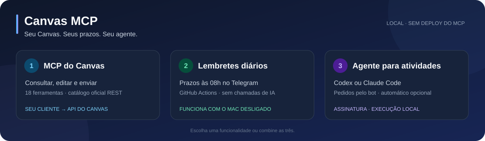
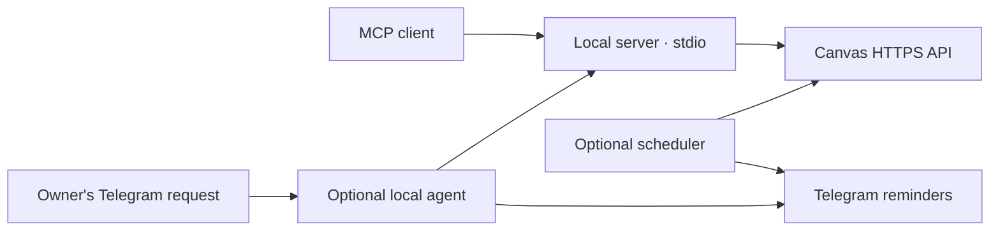

<p align="center">
  
</p>

<p align="center">
  <a href="https://github.com/arthurcuri/mcp-instructure-canvas/actions/workflows/ci.yml"></a>
  <a href="LICENSE"></a>
  <a href="https://github.com/arthurcuri/mcp-instructure-canvas/releases/latest"></a>
  
  
</p>

# Canvas MCP

**Connect your AI assistant to Canvas LMS. Read courses and deadlines, work with the Canvas API, and optionally receive Telegram reminders.**

An independent, MIT-licensed [Model Context Protocol](https://modelcontextprotocol.io/) server for personal Canvas installations. Configure your institution's HTTPS URL and your own access token; no hosted service is required. Works with MCP clients that support local stdio, including Claude Code, Codex, Claude Desktop, Gemini CLI, Cursor, and Kiro.

[Português (Brasil)](README.pt-BR.md) · [Installation](docs/setup.md) · [API guide](docs/api.md) · [Contributing](CONTRIBUTING.md) · [Changelog](CHANGELOG.md)

## What you can do

| Feature | Capabilities | Runs on |
|---|---|---|
| Canvas MCP | Read courses, assignments, rubrics, modules, pages, and personal submission status; discover REST operations; use GraphQL and file transfers | Your MCP client's local process |
| Reminders, optional | Read deadlines and send summaries to your Telegram chat, without model calls | GitHub Actions or your own scheduler |
| Telegram agent, optional | Ask a local Codex or Claude Code agent for help; prepare files and submit work when authorized | Your computer, using your provider account |

The server exposes **18 tools**, or **14 with `CANVAS_READ_ONLY=true`**. Its bundled catalog contains **1,118 documented REST operations in 144 groups**, captured on October 13, 2026. Operations remain subject to your Canvas account's permissions and institution settings. Catalog coverage does not mean every operation has been tested against a live institution.

Installation leaves reminders, agents, and automatic submissions inactive. The MCP server makes no model calls; your assistant may use its own quota when using tools. Agent tasks use the selected provider's account and limits.

## Quick start

You need **Python 3.11+**, Git, and [uv](https://docs.astral.sh/uv/getting-started/installation/). The commands below target macOS/Linux. The checkout requests Python 3.12 through `.python-version`; uv can install it.

```sh
git clone https://github.com/arthurcuri/mcp-instructure-canvas.git
cd mcp-instructure-canvas
uv sync --locked
if [ ! -f .env ]; then cp .env.example .env; fi
chmod 600 .env
```

Edit `.env` in your editor:

```dotenv
CANVAS_API_URL=https://canvas.example.edu/api/v1
CANVAS_API_TOKEN=your-personal-canvas-token
CANVAS_TIMEZONE=UTC
CANVAS_READ_ONLY=true
```

Replace the example URL with your institution's Canvas origin. Create a personal token in **Canvas → Account → Settings → Approved Integrations → New Access Token**, if your institution allows it. See [token setup and configuration](docs/setup.md) if that option is unavailable. Keep the token in `.env`; client registrations only need its file path.

Verify your configuration with a read-only account check:

```sh
uv run canvas-mcp-server --test
```

Register the MCP server with your client. Run **one** of these from the repository root:

```sh
# Claude Code
claude mcp add --scope local --transport stdio canvas -- \
  "$PWD/.venv/bin/canvas-mcp-server" --env-file "$PWD/.env"
```

```sh
# Codex
codex mcp add canvas -- \
  "$PWD/.venv/bin/canvas-mcp-server" --env-file "$PWD/.env"
```

Restart your client and check its MCP tool list. Existing installations may use the local name `canvas-pucminas`; keep that registration instead of adding a duplicate. The name is a client label, and the institution is configured by `CANVAS_API_URL`.

For other clients, absolute-path JSON/TOML examples, and troubleshooting, see [the setup guide](docs/setup.md). You can also install from [release wheels or Docker images](docs/packages.md); source installation is needed for the complete agent setup.

## Try it

Ask your assistant:

- “List my active Canvas courses.”
- “What assignments are due in the next seven days across all my courses?”
- “Read the full description and rubric for assignment 67890 in course 12345.”
- “Find the documented Canvas API operation for listing announcements.”

Use `get_due_assignments` for deadline summaries and `get_assignment` for complete instructions. Without `CANVAS_DEFAULT_COURSE_ID`, provide a `course_id` or request `all_courses=true` for deadlines. Dates use `CANVAS_TIMEZONE` and preserve the student's effective due dates.

To make changes, set `CANVAS_READ_ONLY=false`, reconnect the MCP server, and explicitly request the action. Uploading a file and submitting an assignment are separate operations. Writes are never retried automatically; after a network failure, check Canvas before repeating an action.

## Documentation

| Guide | Contents |
|---|---|
| [Setup](docs/setup.md) | Tokens, configuration, supported clients, and troubleshooting |
| [API](docs/api.md) | Tool reference, REST discovery, pagination, GraphQL, uploads, and submissions |
| [Reminders and scheduling](automation/README.md) | Private snapshots, Telegram setup, GitHub Actions, launchd, and cron |
| [Optional agents](docs/agents.md) | Provider/account setup, approvals, conversation context, and automatic mode |
| [Packages and releases](docs/packages.md) | Wheels, Docker, mounted files, and maintainer release procedure |
| [Validation record](docs/validation.md) | What was tested, how, and the limits of live verification |
| [Security](SECURITY.md) | Credential handling, data boundaries, and vulnerability reporting |
| [Roadmap](ROADMAP.md) | Current priorities and contribution opportunities |

## Architecture



The MCP process has no public HTTP listener. Reminders run independently and make only Canvas reads. Local agents require a running computer and a separately selected provider. See [AGENTS.md](AGENTS.md) for the module map and development invariants.

## Contributing

Contributions are welcome: bug reports, reproducible tests, documentation, translations, and focused code changes. **You do not need a Canvas account, token, Telegram bot, or paid AI account to run the tests.**

Read [CONTRIBUTING.md](CONTRIBUTING.md) for the development workflow, test requirements, and review expectations. Use the [issue templates](https://github.com/arthurcuri/mcp-instructure-canvas/issues/new/choose) for bugs and feature proposals. Community interactions follow the [Code of Conduct](CODE_OF_CONDUCT.md). Report vulnerabilities privately as described in [SECURITY.md](SECURITY.md).

## Acknowledgments and license

An independent implementation inspired by [vishalsachdev/canvas-mcp](https://github.com/vishalsachdev/canvas-mcp) and [mbcrosiersamuel/canvas-mcp](https://github.com/mbcrosiersamuel/canvas-mcp), built with the [official MCP Python SDK](https://github.com/modelcontextprotocol/python-sdk/tree/v1.x) and the documented Instructure APIs.

[MIT license](LICENSE). Not affiliated with or endorsed by Instructure or any educational institution.
